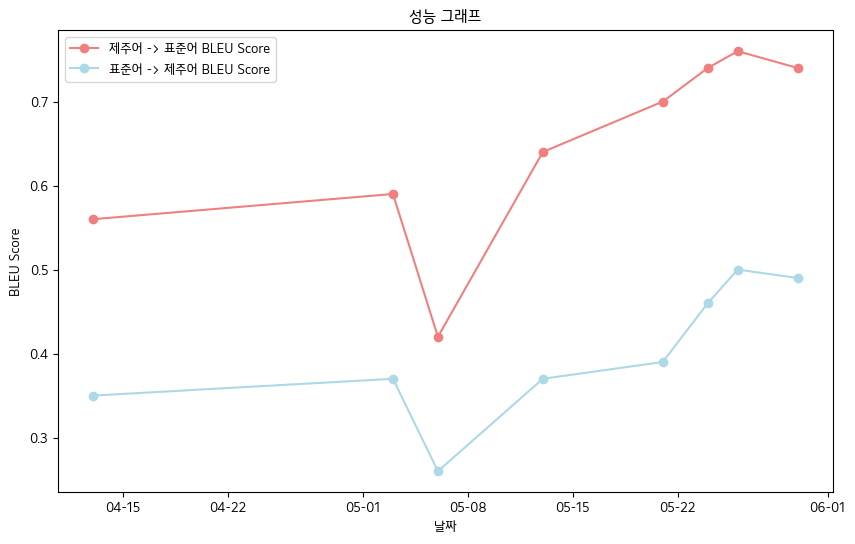

# 🌊 제주어, 표준어 양방향 음성 번역 모델 생성 프로젝트 
  
## 모델 사용법
```python
import torch
from transformers import AutoTokenizer, AutoModelForSeq2SeqLM
  
## Set up the device (GPU or CPU)
device = torch.device("cuda" if torch.cuda.is_available() else "cpu")

## Load the tokenizer and model
tokenizer = AutoTokenizer.from_pretrained("Junhoee/Kobart-Jeju-translation")
model = AutoModelForSeq2SeqLM.from_pretrained("Junhoee/Kobart-Jeju-translation").to(device)

## Set up the input text
## 문장 입력 전에 방향에 맞게 [제주] or [표준] 토큰을 입력 후 문장 입력
input_text = "[표준] 안녕하세요"

## Tokenize the input text
input_ids = tokenizer(input_text, return_tensors="pt", padding=True, truncation=True).input_ids.to(device)

## Generate the translation
outputs = model.generate(input_ids, max_length=64)

## Decode and print the output
decoded_output = tokenizer.decode(outputs[0], skip_special_tokens=True)
print("Model Output:", decoded_output)
```
```python
Model Output: 안녕하수꽈
```
  
## 🎯 1. 프로젝트 소개
### 🧑‍🤝‍🧑 **팀원**
- **비타민 12기 : 구준회, 이서현, 이예린**
- **비타민 13기 : 김윤영, 김재겸, 이형석**
- 대표 연락처 : kujoon13413@gmail.com

### 📅 **시기**
- **2024년 1학기**

### 🕹️ **주제**
- **제주 방언과 표준어 양방향 번역 모델 생성**

### 🎯 **목표**
- 제주 방언에 대한 이해를 증진시키고, 제주 문화의 보존에 기여하고자 합니다.
- 제주 지역도민과 원활한 의사소통을 도모합니다.
- 제주 사투리와 한국어 표준어 사이를 연결하는 양방향 번역 모델을 개발합니다.
- 음성 인식 기능과 사용자 인터페이스를 구현합니다.

## 📊 2. 데이터 수집
- **AI-Hub에서 수집한 데이터**
  - 한국어 방언 발화 데이터
  - 중·노년층 한국어 방언 데이터

- **Github에서 수집한 데이터**
  - 카카오 JIT 제주 방언 데이터

- **그 외 데이터**
  - 생활제주어 데이터 (제주어사전 웹페이지 크롤링)
  - 뭐랭하맨 데이터 (유튜버 뭐랭하맨 영상 중 가사 번역 영상 참고해 데이터 수집)
  - 제주방언 그 맛과 멋 데이터 (도서 '제주방언 그 맛과 멋'에서 데이터 수집)
  - 부에나도 지꺼져도 데이터 (도서 '부에나도 지꺼져도'에서 데이터 수집)
  - 2018 제주어 구술 자료집 (평가용으로 수집)

## 💻 3. 모델 학습
### 3-1. 모델 관련
- **사전 학습 모델을 불러와 Fine-tuning 하는 방식**으로 학습하였습니다.
- 번역 모델 개발을 위해 활용한 사전 학습 모델:
  - **gogamza/kobart-base-v2**  

- **사전 학습 모델 선택 기준**
  - 번역 Task에 적합한 모델인가?
  - 한국어로 학습되어 있는가?
  - 모델 용량이 그리 크지 않고 학습 속도가 빠른가?

- 고려해봤지만 선택하지 않은 모델:
  - T5 (학습 시간이 너무 긴 문제가 있음)
  - Jebert (성능이 만족스럽지 않았음)
 
### 3-2. 학습 방법
- **학습 방법론**
  - **source -> target** 형식으로 학습
  - **문장 입력 전에 [제주] 혹은 [표준] 토큰을 추가하여 번역 방향을 명시하고 이를 함께 학습**
  - datasets 패키지의 Dataset을 활용하여 언어 모델 학습에 최적화된 형태로 변환
 
- **주요 파라미터 설정**
  - **max_length : 64**
  - **batch_size : 32**
  - **traning_rate : 처음에는 2e-5에서 시작해 학습이 진행되면서 점차 줄어들도록 설정**
  - **epochs : 3**
 
## 📈 4. 주요 성과
- **최종 BLEU 점수 - 제주어 구술 자료집 데이터 기준**
    - **제주어 -> 표준어 : 0.76**
    - **표준어 -> 제주어 : 0.5**
- **BLEU Score 성능 표**

| 날짜          | 04-13 | 05-03 | 05-06 | 05-13 | 05-21 | 05-24 | 05-26 | 05-30 |
|---------------|------------|------------|------------|------------|------------|------------|------------|------------|
| **제주어->표준어 BLEU Score** | 0.56 | 0.59 | 0.42 | 0.64 | 0.70 | 0.74 | **0.76** | 0.74 |
| **표준어->제주어 BLEU Score** | 0.35 | 0.37 | 0.26 | 0.37 | 0.39 | 0.46 | **0.50** | 0.49 |

- 전체적으로 **우상향하는 BLEU Score을 기록**하였습니다.


- **인터페이스 구현**

- **음성 인식 기능**
  - **STT**
    - 허깅페이스에서 Whisper 모델 받아서 Fine-tuning 진행
    - 제주어 억양 학습해 text로 변환
  - **TTS**
    - 허깅페이스에서 glos TTS, hifigan 모델 받아서 fine-tuning 진행
    - 제주어 억양으로 음성 표현 시도했지만 실패...
    - 표준어 음성으로 대신 표현 (gtts 사용)
 
## 🔍 5. 향후 계획  
- 양질의 데이터 확보를 위해 추가적인 데이터 수집과 문법적 미세 조정을 통한 전처리 수행
- 음성 인식 모델의 억양 인식 능력 향상
- 웹 구현 및 모바일 앱 개발 계획
 
    
## 🧹 6. 참조
- **데이터 출처**
  - 한국어 방언 발화 데이터 (AI-Hub 제공) : https://www.aihub.or.kr/aihubdata/data/view.do?currMenu=115&topMenu=100&aihubDataSe=data&dataSetSn=121
  - 중·노년층 한국어 방언 데이터 (AI-Hub 제공) : https://www.aihub.or.kr/aihubdata/data/view.do?currMenu=115&topMenu=100&aihubDataSe=data&dataSetSn=71558
  - 카카오 JIT 제주 방언 데이터 (카카오브레인 Github 참조) : https://github.com/kakaobrain/jejueo
  - 생활제주어 데이터 (제주어사전 참조) : https://www.jeju.go.kr/culture/dialect/lifeDialect.htm
- **모델 출처**
  - Kobart Hugging Face : https://huggingface.co/gogamza/kobart-base-v2
  - Whisper Hugging Face : https://huggingface.co/openai/whisper-large-v2
  - Kobart Github : https://github.com/SKT-AI/KoBART
